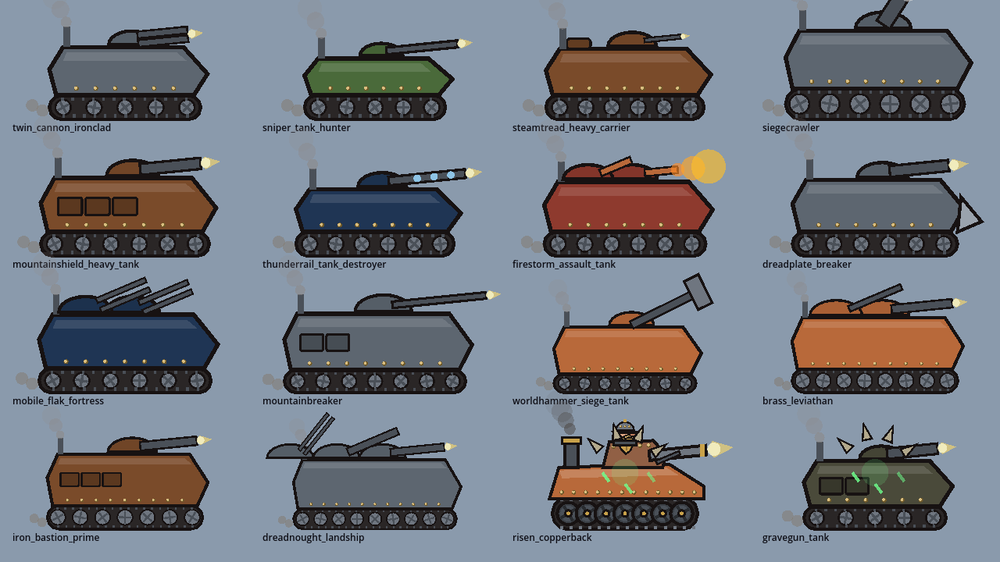
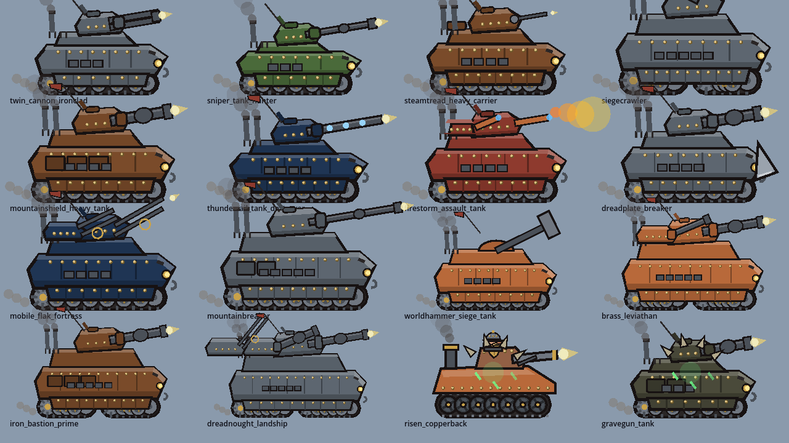
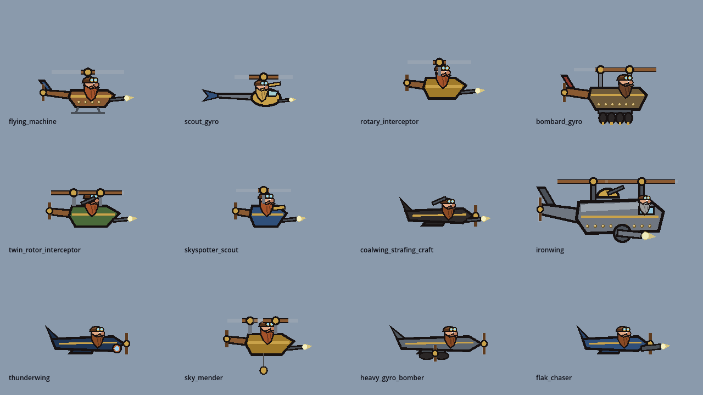
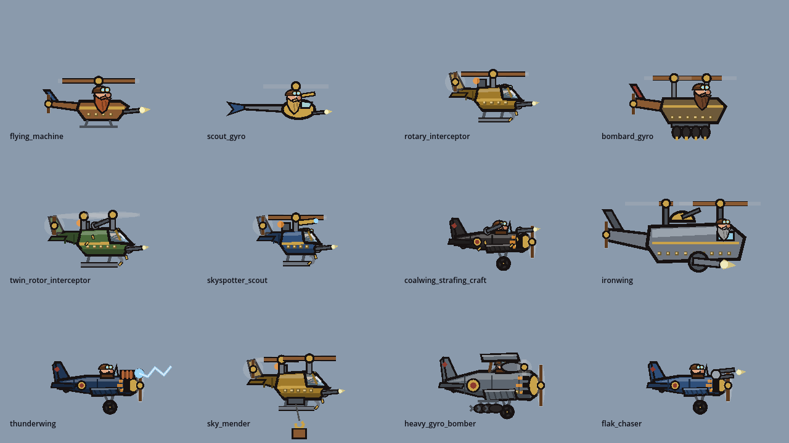
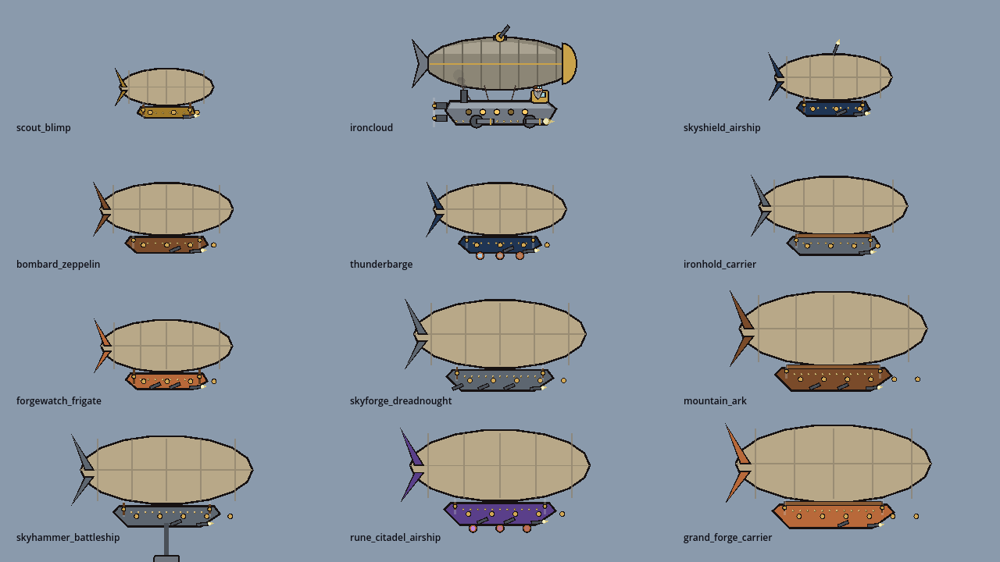
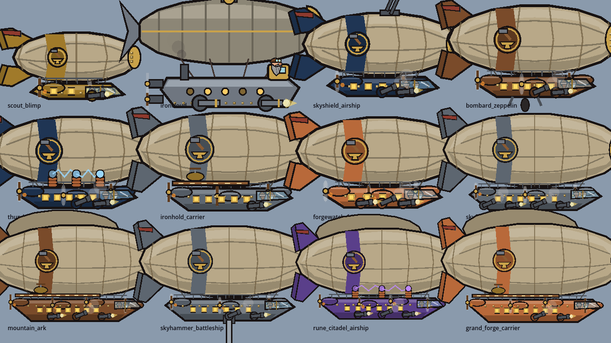

# M006b — Iron & Sky: the machine visual overhaul

Engine: Godot 4.3-stable (GL Compatibility). Date: 2026-11-01. Version 0.6.1-M006b (Android version code 8).
A visual-only patch on top of M006, built from `docs/MASTER_PROMPT_M006b.md`. Everything marked **tested** ran in this
build environment: headless, or on a virtual X display with software OpenGL for the art sheets, the visual checks
and the benchmark. **The build has not been run on an Android phone**; no on-device frame rate is claimed.

**No gameplay changed.** No unit id, stat, weapon, behaviour, art parameter, aim point or hit box was touched; aim
points still come from the data heights (`h`), not from the drawn geometry. The proof is in §6: a stage-sim sample
gives the same results as M006.

---

## 1. Tanks and ground vehicles (`ArtKit._veh`, 24 kit vehicles)

| Before (M006) | After (M006b) |
|---|---|
|  |  |

- **Weight classes** from the hull length: light (< 64), medium (64–84), heavy (84–104), super-heavy (≥ 104 or
  crawler). Track height, skirts, superstructure, exhaust count, turret size and the pennant follow the class, so a
  scout tank, a medium, a heavy and a landship no longer read as the same box at different sizes.
- **Hull**: separate lower hull and glacis with a lit top band, a brighter glacis and a shadowed belly; panel seams
  and rivet rows; a casemate/superstructure on medium and heavier hulls; **side skirts** with seams and bolts over the
  tracks; vision slit, brass headlamp, tow hook, engine grille, spare track links (or a shovel on light hulls),
  stowed plates, the ram on rammers.
- **Running gear** (`_track_unit`): a toothed **drive sprocket** at the rear and an **idler** at the front that turn
  with `walk`; road wheels whose hub bolts rotate; **return rollers** on the top run; track links on the top and
  bottom runs travelling in opposite directions. Wheeled hulls get spoked wheels, mudguards and leaf springs; crawlers
  two track units and an articulation joint.
- **Turrets** (`_turret2`) by kind: sloped, shaded turret body with rivets and a **mantlet**; `cannon` / `heavy` /
  `long` / `rail` / `twin` barrels with a highlight, **muzzle brake**, **bore evacuator** on heavy and long guns, glowing
  rail coils; `mg` with a stuttering flash; `flame` with a pilot light and a flame tongue; `aa` twin barrels with a
  ring sight; `mortar`. Secondary turrets on super-heavies are smaller. The `hammer` kind keeps its M006 painter.
- **Commander**: a dwarf in the cupola of the main turret, helmet and goggle band, beard; he looks about at idle and
  **ducks** into the hatch when the main gun fires; the hatch lid stands open behind him.
- **Firing** (from `atk`): the barrel slides back into the mantlet, the turret rocks back on its ring, the muzzle
  flashes, a smoke cloud rolls off the muzzle, a **brass case** is kicked out of the rear hatch.
- **Movement and life**: thrown dirt behind moving tracks, exhaust stacks belching darker under way and after a shot,
  a radio antenna that whips with motion and the shot.
- **Damage states**: below 50 % scorch marks and black smoke from the engine deck; below 25 % flames. The legacy
  **Copperback** and **Brasshound** keep their M001 art and gain the same two damage states (`ArtKit.legacy_damage`).

## 2. Aircraft (`ArtKit._air`, 18 kit aircraft)

| Before | After |
|---|---|
|  |  |

- **Rotary / twin-rotor / gunship**: a shaded pod with a **glazed canopy** (frame and glint) over the pilot, a tail boom
  with ribs, a fin and stabiliser, a **tail rotor blur disc**, landing skids, a brass trim band and rivets, an exhaust
  stack with a flickering flame; the mast carries a **rotor blur disc** plus the visible blades (two rotors on
  twin-rotor craft). Gunships add portholes and a stub wing with a rocket pod.
- **Winged / bomber**: a tapered, shaded fuselage, a brass cowling with three **exhaust stubs flickering flame**, a
  **prop blur disc** with blades, an open cockpit with a windscreen, a fin with a **hinged rudder that moves**, a
  stabiliser, ribbed wings (the far wing tip peeks out behind the fuselage), fixed landing gear with a turning wheel
  and a tail wheel, a brass-and-red roundel. **Bombers** are biplanes: a strut-braced upper wing with bracing wires and
  a wing engine nacelle with its own prop.
- **Pilot**: goggled dwarf head (now drawn through the transform stack) with a **scarf that streams back and
  flutters**.
- **Weapons**: machine guns kick back and drop **brass casings**; the cannon recoils and smokes; flak twins recoil
  alternately; coil guns glow and throw a **lightning arc**; the flamer keeps a pilot light; rockets sit on a rail and
  leave it with a smoke trail. **Bomb racks** show three bombs, the last bomb or an empty rack (from the bomber's real
  ammunition).
- Sky Mender's winch lowers a hook with a crate of spare parts; scouts carry a telescope.
- **Damage**: below 50 % a smoke trail streams from the engine and the hull is scorched; below 25 % the engine burns.

## 3. Airships (`ArtKit._ship`, 11 kit airships + the supply barge)

| Before | After |
|---|---|
|  |  |

- **Envelope**: lit crown and shadowed belly bands, three longitudinal **girders** and curved **gore seams** that follow
  the gas bag, a riveted **brass nose cap**; a **coat-coloured band** with the **hammer-and-anvil** emblem (the supply
  barge keeps its gold M006 roundel). Hulls of length ≥ 230 carry a **second, upper envelope** strutted to the first.
- **Tail**: upper and lower fins with **hinged rudders that swing**, and a pennant streaming from the upper fin.
- **Rigging** from the envelope down to the gondola; **engine pods on outriggers** with pusher-prop blur discs and
  exhaust glow: two pods on small ships, three on medium, four on the largest.
- **Gondola**: a keel hull with a lit roof band and shadowed keel, railings with posts, rivets, **portholes with warm,
  flickering light**, a **glazed bridge** at the bow with two dwarf crew (helmets, beards).
- **Role fittings**: carriers a striped **flight deck** with a **parked gyro** idling its rotor; the Skyhammer battleship
  a piston ram with a shock arc on the stroke; coil ships copper **tesla coils** that arc to each other; the bombard
  zeppelin **bomb-bay doors** that open and drop; flak ships a dorsal twin flak mount; broadside guns **recoil** and roll
  smoke off the side.
- **Damage**: below 50 % patched holes on the envelope, scorch and a smoking engine; below 25 % the envelope burns.

## 4. War frames — every one, every state (`ArtMechs`, 28 frames)

Sheets: `docs/screenshots/m006b_mechgrid_0.png` … `_6.png` (7 sheets × 4 frames, columns stance / combat / wind-up /
strike / follow-through / recovery / ability). Before: `docs/screenshots/m006b_before/mechgrid_*.png`.

A single **combat timeline** (`ArtMechs.timeline(atk, windup)`) now drives every arm:

| State | Driven by | What the frame does |
|---|---|---|
| Stance | `engage` 0 | Relaxed arms, upright, head scans the field slowly |
| Combat stance | `engage` 1 | Lower (crouch 2–3.5 px by weight class), wider feet, slight forward lean, guard up |
| Wind-up | `windup` 1 | Melee arms coil back (with a small tremble, less on heavy frames), body leans back and crouches, weight on the back foot; guns settle on target |
| Strike | `atk` 1 → 0.75 | The arm snaps to the hit pose; **smear** (arcs for claws and hammers, speed streaks for punches and thrusts); **impact** — dust and chips for claws and hammers, shock rings for fists and shields; the body lunges (front foot steps in) |
| Follow-through | `atk` 0.75 → 0.4 | The arm carries past the hit, then eases toward a hold |
| Recovery | `atk` < 0.4 and `gag` | The arm returns to guard with a **spring overshoot** that is slower and heavier on big frames |
| Ability | `ability_anim` | Power pose for melee arms (guns keep aiming) |
| Stun | `stun_t` | Arms hang, the frame slumps forward, head drops, sparks |

- Per-family poses (`ARM_POSE`) for claw, big claw, fist, big fist, gauntlet, grabber, drill, piston hammer, tower
  shield, buckler, emitter, vent, brace, bracer, stub and loader; two-handed hammers and axes have their own
  overhead-swing path with a ground impact. **Guns** climb on the shot, the forearm kicks back (more on cannons and
  big flamers) and smoke curls from the muzzle; shoulder mounts recoil, twin AA barrels alternate, mortars throw a
  smoke column; shoulder actuator pistons extend on the strike.
- Body participation (`body_from`): melee coil leans back −0.12 rad, crouches 3 px and shifts back 2 px; the hit
  leans in and lunges 7 px; guns rock back. Heavier frames move less (scaled by weight class).
- Corrupted frames (Cursed Ironclad, Possessed Drillwalker) inherit everything through `_corrupt`.

## 5. Performance

All numbers **tested** with `tests/bench.tscn` under a virtual display with **software OpenGL** (llvmpipe, 2 CPU
cores): absolute frame times are far slower than any phone GPU and only the before/after ratio means anything. 150
measured frames after 200 warm-up frames; units have 6× health so the crowd stays. "Before" is the M006 commit
(`4fc3bcc`) with the identical bench script. New bench mix `--mix=machines` (tanks, war frames, landships, crawlers,
two airships, bombers, gunship, rocketwing). Low = Performance preset (the Android default), Balanced = cached atlas
with 4 pages, High = live procedural drawing (desktop default).

| Preset · crowd | M006 frame | M006b frame | Δ | M006 draw calls | M006b draw calls |
|---|---|---|---|---|---|
| Low · M006 crowd (default mix) | 113.5 ms | 101.9 ms | **−10 %** | 631 | 398 |
| Low · machines (tank/airship-heavy) | 104.5 ms | 107.6 ms | **+3 %** | 1016 | 334 |
| Low · air peak (24 undead flyers + airships) | 116.7 ms | 95.9 ms | **−18 %** | 928 | 394 |
| Balanced · M006 crowd | 113.1 ms | 107.5 ms | −5 % | 493 | 394 |
| Balanced · machines | 93.7 ms | 94.1 ms | +0.4 % | 334 | 337 |
| Balanced · air peak | 117.4 ms | 104.5 ms | −11 % | 540 | 404 |
| High (live) · machines | 203.4 ms | 231.3 ms | **+14 %** | 4016 | 5014 |
| High (live) · air peak | 260.0 ms | 270.3 ms | +4 % | 5845 | 5978 |

**Why the cached presets got faster although the art got richer**: the first bench of the new art showed +22 % on Low
machines and 2,860 draw calls: the bigger cells filled the 3-page atlas, the cache **recycled whole pages** and every
unit whose cells were evicted drew itself live until re-baked (thrash; M006 did this too, less often). Two fixes:
1. **No-thrash pose cache** (`PoseCache._alloc` / `request`): when the atlas is full, an art that already owns a working
   set of `MIN_POSES` (8) cells **snaps to its nearest baked pose** instead of evicting a page; only an art with fewer
   than 8 cells may still recycle the oldest page, so a late arrival is never frozen on one pose.
2. **Batched rivets** (`Painter.rivets`): a row of rivets is now two `draw_multiline` calls instead of two 64-segment
   circles per rivet. This touches every art that uses rivets (2.6 px dots instead of 1.4 px-radius circles; not
   distinguishable at battle zoom) and is what brought the High preset back from +46 % to +14 %.
The ship and aircraft painters were also slimmed (girders and gore seams batched into one multiline each, portholes
as two batched calls, fewer ellipse points on blur discs, plain rectangles instead of rounded ones for small parts).

**Budget check (§7)**: frame ≤ +10 % holds on Low and Balanced for every crowd; **High · machines is +14 %, over the
budget** — High is the desktop live-draw preset, not the phone default, and is reported rather than hidden. Draw calls
at steady state are ≤ 404 on every cached preset (≤ 600 budget); the High preset was already 4,000–5,800 in M006.

**Live-draw cost per art** (`tests/artcheck.tscn -- --cost_only`, GDScript time per `draw_unit`, mean of 7 poses,
same machine, both trees; budget ≤ 3× M006):

| Family | Median vs M006 | Worst |
|---|---|---|
| War frames (28) + legacy Copperback/Brasshound | ×1.00 | ×1.5 (Steam Loader: smears, impact dust and the loader-arm timeline) |
| Corrupted (8) | ×0.86 | ×1.8 (Gravegun Tank, which uses the new tank painter) |
| Tanks (24) | ×1.6 | ×2.24 (Dreadnought Landship, 796 → 1783 µs) |
| Aircraft (18) | ×1.7 | ×2.20 (Coalwing, 460 → 1010 µs) |
| Airships (11) | ×2.0 | **×2.58** (Mountain Ark, 606 → 1565 µs) |

Timing is single-run GDScript wall time on a shared 2-core container; differences under ~±20 % are noise.
Before the slimming pass three arts were over 3× (Mountain Ark ×3.6, Thunderwing ×3.4, Coalwing ×3.3); none are now.

**Pose keys** (re-measured with `tests/bounds.tscn -- --machines`): war frames unchanged; tanks gained `hp_frac`
(snapped to **3 levels**: healthy / < 50 % / < 25 %); kit bombers gained `ammo` (snapped to **3 levels**: full / last
bomb / empty; the legacy Bombard Gyro keeps its per-bomb count); airships unchanged. Cell area: tanks ×1.20,
aircraft ×1.30, airships ×1.15, war frames ×1.02.

## 6. Tests

All **tested**, 0 script errors in every suite.

| What | Result |
|---|---|
| Full M006 suite set after the overhaul: registry 2, art_m006b 4, cache 1, combat 8, boss 1, mecha 41, mecha_scenarios 6, mecha_audio 2, mecha_save 1, giants 18, giants_scenarios 4, roster 1, bosses_all 15, hazards 5, hazards_m006 6, boss_phases 4, boss_phases_m006 3, air_war 8, motion 2, stars 4, save_write/verify 2, m005_save 1, m006_save 1, ui 8, ui_m005 4, ui_m006 3 | **27 suites, 155/155 passed** |
| Re-run after the performance pass (rivets, pose cache, painter slimming): registry, cache, art_m006b, combat, mecha, giants, air_war, motion, ui, ui_m006 | 91/91 passed |
| **Visual-only proof**: stages 010, 040, 062, 070, 080, 090, played (auto-commander) and idle, compared with M006's `build/sims_final.csv` | **12/12 identical** (result, time, stronghold %, citadel %, kills, losses, deployed) — run twice, before and after the performance pass |
| **`art_m006b`** (new, headless): 92 machine arts (28 war frames, 24 tanks, 18 aircraft, 12 airships, 8 corrupted, 2 legacy) draw to the end in 18 animation states each; all 18 arm families move through stance → combat → wind-up → strike → follow-through → recovery; every war frame reads `atk/windup/engage/gag/walk/ability_anim` and every vehicle/aircraft/airship its running-gear, firing and damage keys; the pose cache stays bounded (tank damage 3 states, bomber ammo 3 states) | 4/4 |
| **`artcheck`** (new, rendered): 91 arts × 7 poses inside their measured bounds; running gear / props change between walk and `t` samples (no frozen machine); every war frame's pixels differ between stance, wind-up, strike and recovery | 3/3 PASS |
| Before/after art sheets (tanks, aircraft, airships, corrupted, all 28 war frames in 7 states) | looked at by eye; in `docs/screenshots/m006b_*` and `m006b_before/` |

`boss_counters` (the long scripted boss playthroughs) was not re-run; it depends only on gameplay, which the stage
sample shows unchanged.

## 7. Honest limits

- Art sheets and visual checks were looked at by eye on a desktop-sized render; **readability of the new detail at
  phone size is unverified on a device**. Small details (casings, scarf, rivets, crew heads) are 1–3 px at battle
  zoom on a phone and will read as texture rather than as objects.
- Airships use the same envelope for all hulls; they now differ by pods, fittings, band colour, the second envelope
  and the gondola length, not by a different envelope shape per class.
- The legacy Copperback, Brasshound, Flying Machine, Scout Gyro, Bombard Gyro, Ironwing and Ironcloud keep their
  M001 art (as the prompt asks); only the two legacy ground vehicles gained damage states (Ironcloud already had
  them).
- **Pose-cache snapping**: on a full atlas, an art with a working set now snaps new poses to its nearest baked one
  instead of evicting a page. This is what made the cached presets faster, but in very crowded battles a machine may
  show a near pose (e.g. a neighbouring walk step) rather than the exact one for longer than before.
- **High preset · machines is +14 %** frame time over M006, above the 10 % budget (see §5).
- Rivets everywhere are now tiny square dots instead of circles (performance); visible only when zoomed far in.
- Damage states are coarse on purpose (three levels for vehicles, aircraft and airships) to keep the pose cache small.
- Engine pods on airships hang in front of the gondola rather than truly beside it; at side view there is no depth.
- The commander ducks on the firing frame and reappears as `atk` decays; with the pose cache stepping `atk` in
  quarters he pops rather than sinks.

## 8. Deliverables

- `build/android/DwarvesVsZombies-M006b.apk` — 0.6.1-M006b, version code 8, debug-signed, zipalign and v1/v2/v3
  signatures verified. Not run on a device.
- `build/linux/DwarvesVsZombies.x86_64` — smoke-tested for 300 frames under a virtual display: exit 0, 0 script errors.
- Project ZIP (excluding `.godot/`, `build/`, `*.import`, `.git`).
- Screenshots: `docs/screenshots/m006b_tanks_0/1.png`, `m006b_tanks_damaged.png`, `m006b_aircraft_0/1.png`,
  `m006b_aircraft_damaged.png`, `m006b_airships.png`, `m006b_airships_damaged.png`, `m006b_corrupted.png`,
  `m006b_mechgrid_0…6.png`, `m006b_battle.png`; before sheets in `docs/screenshots/m006b_before/`.
- Clip: `docs/clips/m006b_machines.mp4` (7 s, tanks, war frames, bombers, gunship and airships against an undead push).
- New tools: `tests/artcheck.tscn`, `tests/artsheet.tscn`, `tests/bounds.tscn -- --machines`, bench `--mix=machines`
  and `--track` (live draws per art), screenshot `--shot=sandbox --machines`.

How to run: `godot --headless --path . res://tests/test_runner.tscn -- --suite=art_m006b`;
`xvfb-run -a godot --path . --rendering-driver opengl3 res://tests/artcheck.tscn [-- --cost_only]`;
`xvfb-run -a godot --path . --rendering-driver opengl3 res://tests/artsheet.tscn -- --group=tanks --pose=state:move,walk:1.2,atk:0.9`.

