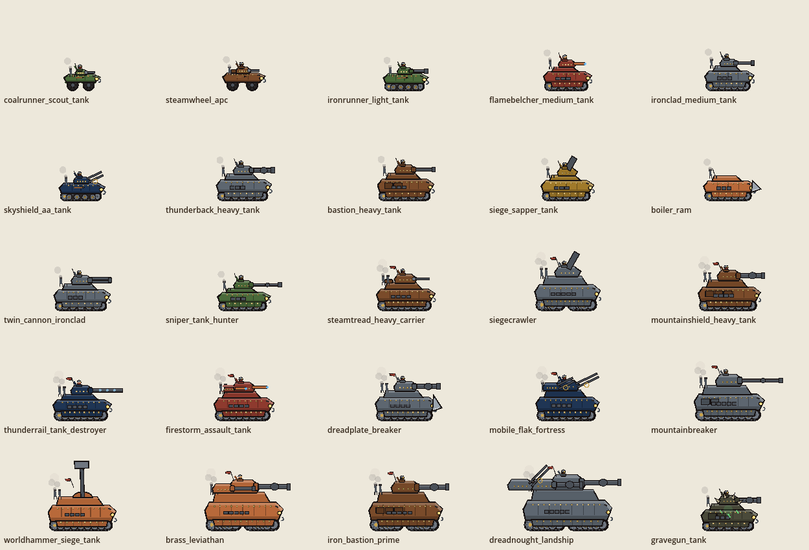
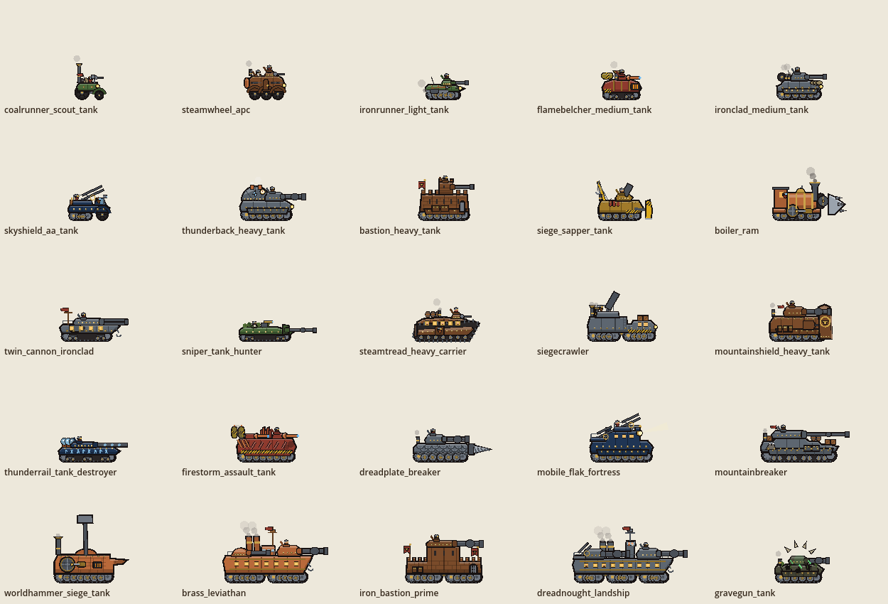
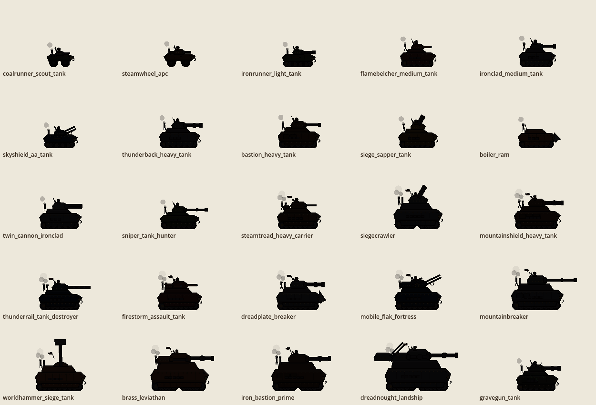
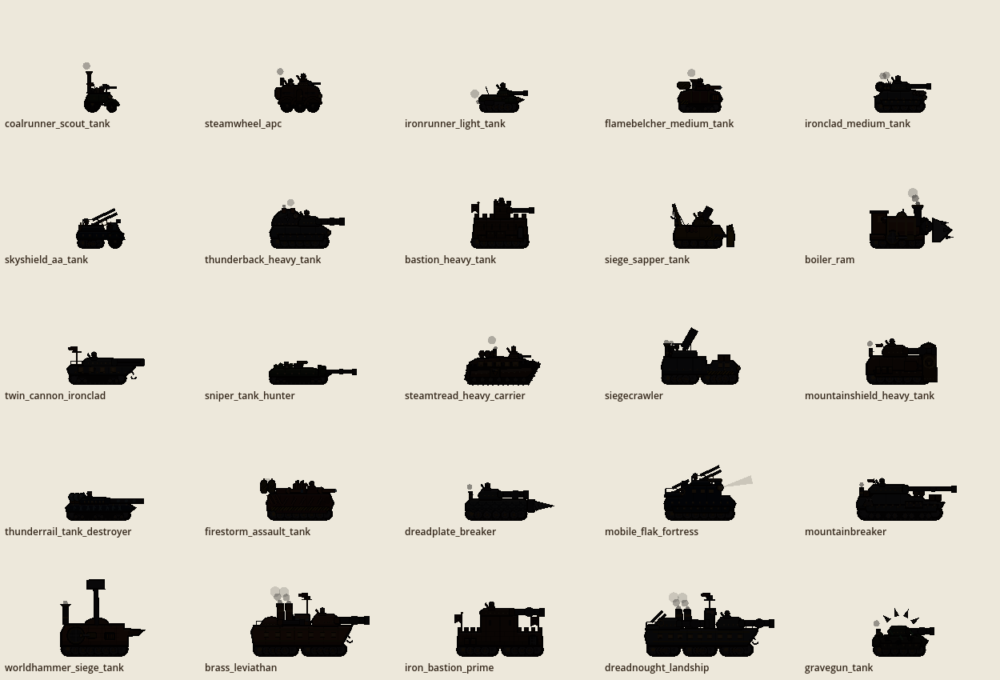

# M006c — Forged Apart: every tank its own machine

Engine: Godot 4.3-stable (GL Compatibility). Date: 2026-11-01. Version 0.6.2-M006c (Android version code 9).
A visual-only patch on top of M006b, built from `docs/MASTER_PROMPT_M006c.md`. Everything marked **tested** ran in
this build environment, headless or on a virtual display with software OpenGL. **Not run on an Android phone.**

**No gameplay changed.** `data/art_kit.json` and every unit's id, stats, radius, aim height and weapons are untouched;
the designs live in a new art-side table. The same six stages give the same results as before (§5).

---

## 1. The problem
M006b made the tanks richer, but all 24 kit vehicles still came out of one hull painter: one lower hull, one
casemate, one skirt and one sloped turret, scaled by length and repainted. Measured on silhouettes (§4), **28 pairs of
tanks overlapped by more than 80 %**, and the worst pair (Twin-Cannon Ironclad and the Gravegun) by 98 %.

| Before (M006b) | After (M006c) |
|---|---|
|  |  |
|  |  |

## 2. How it is built
- **`scripts/art/art_tanks.gd` (`ArtTanks`)**: a design table keyed by art id. `ArtKit._veh` hands any vehicle with a
  design to `ArtTanks.draw` (others fall back to the M006b painter; all 25 have designs).
- Each design gives a **visual size** (`L` × `H`, from 42 to 146 units long), a **chassis**, a **hull profile**
  (any polygon, normalised to the hull's length and height), **turrets** (position, form and size, one per data
  turret, in data order) and a list of **fittings**.
- **Generic form shading for any silhouette**: the profile is clipped against copies of itself shifted down and up,
  so every upward-facing edge gets a lit rim and every downward-facing part a shadow band — a castle wall, a boiler,
  a ship's bow and a wedge are all shaded correctly. Panel seams are clipped to the hull.
- **Chassis types**: spoked **wheels** with mudguards; a three-wheeled **trike**; a **halftrack** (spoked steering wheel
  on a leaf spring + rear track); **tracks** with three road-wheel styles — **big** (four large wheels, no return
  rollers), **medium** (the M006b gear) and **small** (paired wheels on bogie plates); **rhomboid** tracks running
  round the whole hull with links travelling round the loop; **bogies** — two or three articulated track units with
  joints.
- **Turret forms** (added to `ArtKit._turret2`, which keeps all M006b firing animation): `box`, `round` (dome),
  `tower` (battlemented, with an arrow slit), `tub` (open ring with railing, gunner exposed), `flat` (wide and low),
  `casemate` (gun in the front plate, no turret), `ball` (ball mantlet), plus a `pintle` post with a gun shield and
  the M006 `hammer` arm. The commander sits where the form puts him: hatch, tower top or gun ring.
- **Fittings library** (≈70 parts): chimneys (plain or flared brass), a locomotive boiler with smokebox, stack and steam
  dome, a turtle-back boiler hump, vents, pressure gauge, flywheel and connecting rod, fuel tanks with hazard bands,
  firebox grate, crenels, masonry, arrow slits, a gate with portcullis, banners with the anvil, a tower shield, scale
  plates, a drill cone, a ram prow, a dozer blade, a crane, demolition charges, sponsons, firing ports with rifles,
  portholes with passengers, a ramp, capacitors with arcs, rune bands, radiator plates, heat fins, an exhaust
  manifold, searchlight, rangefinder, ladders, mast, bridge tower, deckhouse, funnels, railings, anchor, camo netting,
  scope, spare wheel, sandbags, barrels, crates, coal, a goggled driver, moss and torn plates for the wreck.
- Life and damage are kept: running gear driven by `walk`, exhaust/smoke heavier on the move and after a shot,
  thrown dirt, antenna whip, damage smoke < 50 % and fire < 25 %. **No new pose keys.**

## 3. The 25 designs

| Vehicle | Size | Chassis | What makes it unique |
|---|---|---|---|
| Coalrunner Scout Tank | 42 | trike | An open coal-cart tub with a heap of coal, a tall flared chimney, a goggled driver, a gunner behind a shielded pintle MG |
| Steamwheel APC | 58 | 6 spoked wheels | A tall riveted box on mudguarded wheels, arched side door, rifle barrels poking from firing ports, copper boiler drum at the back, passenger in the roof hatch, round MG cupola |
| Ironrunner Light Tank | 56 | tracks, big wheels | A low beaked wedge on four big road wheels, dome turret set forward, exhaust pipe and muffler along the fender |
| Flamebelcher Medium Tank | 60 | tracks, small wheels | A bulbous stove-shaped body with brass bands, a glowing firebox grate in the nose, a long fuel tank on the rear deck, ball-mantlet flame turret |
| Ironclad Medium Tank | 68 | tracks, skirts | The "standard" dwarven tank: stepped casemate, sloped box turret, spare wheel, sandbags on the glacis, twin exhausts |
| Skyshield AA Tank | 62 | halftrack | A low chassis with a windscreened driver's cab, an open railed gun tub with exposed gunner, ammo rack, periscope |
| Thunderback Heavy Tank | 80 | tracks, skirts | A huge boiler dome humped over the rear (the "thunder back") with steam vents, a pressure gauge and a glowing bolt rune; turret forward |
| Bastion Heavy Tank | 80 | tracks, skirts | A castle wall on tracks: vertical masonry sides, crenellated parapet, arrow slits, a gate with portcullis, a battlemented tower turret, a banner |
| Siege Sapper Tank | 72 | tracks | A hazard-yellow dozer blade on push arms, a crane jib with a swinging hook, demolition charges, petard mortar |
| Boiler Ram | 82 | tracks + flywheel | A steam locomotive on tracks: horizontal boiler with brass bands, smokebox and door, flared smokestack, steam dome and whistle, roofed cab with a lit window and a goggled driver, flywheel driving a connecting rod, spiked ram prow |
| Twin-Cannon Ironclad | 86 | tracks, small wheels | A river monitor: low hull with a raked bow, deck railing, portholes, side sponson, a wide flat twin turret, a mast with a pennant, anchor |
| Sniper Tank Hunter | 84 | tracks, small wheels | Turretless and very low: long gun through a mantlet plate in the glacis, camo netting tufts, a roof scope, commander in a deck hatch |
| Steamtread Heavy Carrier | 92 | rhomboid | Tracks run round the whole hull side; a tall arched carriage above with lit portholes and passengers, a side door with a dwarf in it, barrels on the roof, rear ramp |
| Siegecrawler | 104 | 2 articulated bogies | A two-section machine: a low cab with lit windows and crates up front, a tall mortar kiln behind with an open gun pit, two flared chimneys, a ladder |
| Mountainshield Heavy Tank | 92 | tracks, skirts | A tall tower-shield plate stands before the hull with the anvil in a brass ring; MG sponson; heavy turret behind |
| Thunderrail Tank Destroyer | 92 | tracks, small wheels | A long low capacitor deck with three glowing spheres that arc when firing, cable runs, a glowing rune band along the hull, a flat rail turret |
| Firestorm Assault Tank | 90 | tracks, skirts | A broad box with two ball-mantlet flame turrets fore and aft, a row of glowing radiator plates between them, twin fuel tanks at the stern, heat fins, exhaust manifold, scorched glacis |
| Dreadplate Breaker | 96 | tracks | A low wedge of overlapping scale plates with a huge rotating drill cone on the nose (sparks when it strikes) |
| Mobile Flak Fortress | 96 | tracks, skirts | A stepped fortress with a tall superstructure: AA gun tub on the tower roof and another on the rear deck, ladder, searchlight with a sweeping beam, rangefinder, lit windows |
| Mountainbreaker | 118 | tracks, small wheels | A terraced super-heavy stepped like a mountainside, stowage on every terrace, a peak emblem with snow caps, a very long gun on a wide flat turret |
| Worldhammer Siege Tank | 108 | tracks + flywheel | A forge hull with an anvil-horn front, a big flywheel and rod, a glowing forge grate, a tall flared chimney, the great hammer arm |
| Brass Leviathan | 128 | 2 bogies | A brass warship on tracks: bow, portholes, brass hull bands, deckhouse, two banded funnels, mast with flag, two turrets |
| Iron Bastion Prime | 118 | 2 bogies | A two-tier castle: crenellated outer walls, a central keep with slits and its own parapet, gate with portcullis, two banners, flat turret on the keep |
| Dreadnought Landship | 146 | 3 bogies | A land battleship: long hull with bow, bridge tower with glazed windows, crew, mast and crow's nest, two funnels, two heavy turrets and an AA tub, a row of portholes |
| Gravegun Tank (corrupted) | 74 | tracks, skirts | A smaller, sagging dwarven heavy with a torn, notched roofline, punched-through holes and hanging moss — and no living commander (the corruption overlay stays) |

Before/after sheets at a larger scale: `docs/screenshots/m006c_before/before_tz_1…5.png` and
`docs/screenshots/m006c_tanks_1…5.png`.

## 4. Silhouette uniqueness (tested)
`tests/silhouettes.tscn` renders every vehicle's idle silhouette at one common scale, aligned on its ground centre,
and measures the pairwise overlap (intersection over union of the filled outlines, 300 pairs).

| | M006b | M006c |
|---|---|---|
| Pairs overlapping > 80 % | **28** | **0** |
| Worst pair | 0.977 (Twin-Cannon Ironclad ~ Gravegun) | 0.795 (Steamtread Carrier ~ Dreadplate Breaker) |
| Median pair | 0.601 | 0.549 |

The median moves less than the worst pairs because every tank still occupies the same ground band at the bottom of
the frame; the gain is in the worst cases, which is where "reskin" came from. The first M006c pass still had 5 pairs
above 0.80 (Mountainshield ~ Firestorm 0.84, …); taller shield and hull, a lower Dreadplate and a smaller, sagging
Gravegun brought them under.

## 5. Tests (tested, 0 script errors)

| What | Result |
|---|---|
| registry 2, art_m006b **5** (new check below), cache 1, combat 8, mecha 41, giants 18, air_war 8, motion 2, ui 8, ui_m006 3, roster 1, bosses_all 15 | 112/112 |
| **New check** in `art_m006b`: all 25 vehicles have a design; 25 distinct hull profiles; 25 distinct sizes | PASS |
| All 92 machine arts draw completely in 18 animation states (tanks included) | PASS |
| `artcheck`: drawings inside the re-measured bounds; running gear moves between walk samples; war frames differ by state | 3/3 PASS |
| **Visual-only proof**: stages 010, 040, 062, 070, 080, 090, played and idle | **12/12 identical** to M006/M006b (result, time, stronghold %, citadel %, kills, losses, deployed) |

## 6. Performance

Tested with `tests/bench.tscn` (software OpenGL, 2 shared CPU cores: only the before/after ratio means anything;
run-to-run noise on this machine is about ±8 %). Before = the M006b commit `6a13e22`, same bench script. 150 frames
after 200 warm-up frames.

| Preset · crowd | M006b frame | M006c frame | Δ | Draw calls before → after |
|---|---|---|---|---|
| Low · default crowd | 107.0 ms | 100.9 ms | −6 % | 398 → 393 |
| Low · machines (tank-heavy) | 111.0 ms | 107.5 ms | −3 % | 334 → 327 |
| Balanced · default crowd | 104.9 ms | 113.0 ms | +8 % (no tank art in this crowd changed: noise) | 394 → 399 |
| Balanced · machines | 98.6 ms | 98.1 ms | −0.5 % | 337 → 335 |
| High (live) · default crowd | 324.2 ms | 337.1 ms | +4 % | 7138 → 7138 |
| High (live) · machines | 262.7 ms | 271.7 ms | +3 % | 4918 → 4950 |

All within the §2.6 budget (+10 %). **Live-draw cost per tank** (`tests/artcheck.tscn -- --cost_only`, mean of 7
poses, budget ≤ 2× M006b): median ×1.16 over the 25 vehicles (mean 1244 → 1582 µs); worst Firestorm ×1.83
(1113 → 2039 µs), Ironclad Medium ×1.80, Landship ×1.73; three got cheaper (Worldhammer ×0.81, Steamtread ×0.90,
Gravegun ×0.97). Non-tank arts, unchanged in code, measured ×0.90 median — the size of the timing noise.
Bounds re-measured for all machines (`tests/bounds.tscn -- --machines`); no new pose keys.

## 7. Honest limits
- Designs were judged by eye on desktop-sized renders. **How they read on a phone in battle is unverified.**
  The fine details (rune glyphs, gauges, portholes, crew) are 1–3 px at battle zoom; the silhouettes are what carry
  identity there.
- **Visual size changed, hit boxes did not.** A tank's collision radius and aim height still come from its data, so
  the smallest designs (Coalrunner, Ironrunner) are slightly smaller than their hit circles and the largest (the
  Landship) slightly longer than its own; shots land on the data aim point as before.
- The silhouette metric is coarse (filled outline overlap, at one pose); it shows the reskin problem is gone in the
  worst pairs, not that every pair is maximally different.
- Turret weapons still use the M006b barrel set (cannon, heavy, long, rail, twin, mg, flame, aa, mortar); the
  variety is in the turret forms and hulls, not in new gun types.
- The legacy Copperback and Brasshound keep their M001 art (unchanged, as before).

## 8. Deliverables

- `build/android/DwarvesVsZombies-M006c.apk` — 0.6.2-M006c, version code 9, debug-signed, zipalign and v1/v2/v3
  verified, version string checked in the manifest. Not run on a device.
- `build/linux/DwarvesVsZombies.x86_64` — 300-frame smoke test under a virtual display: exit 0, 0 script errors.
- Project ZIP (excluding `.godot/`, `build/`, `*.import`, `.git`).
- Screenshots: `docs/screenshots/m006c_lineup.png` (all 25 in colour at one scale), `m006c_silhouettes.png`,
  `m006c_tanks_1…5.png` (zoomed, moving and firing), `m006c_battle.png`; before: `docs/screenshots/m006c_before/`.
- Clip: `docs/clips/m006c_tanks.mp4` (8 s: scout, Boiler Ram, Bastion, Dreadplate, Siegecrawler, Steamtread,
  Thunderback and Leviathan rolling into an undead line). Screenshot tool: `--shot=sandbox --tanks`.

